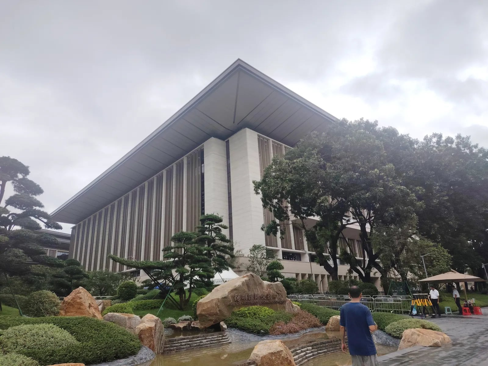
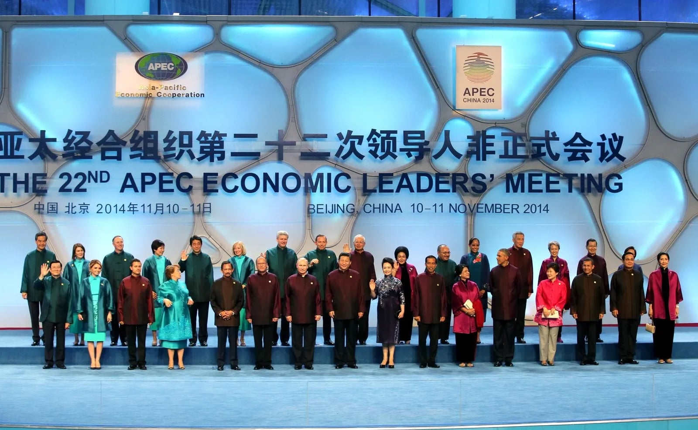
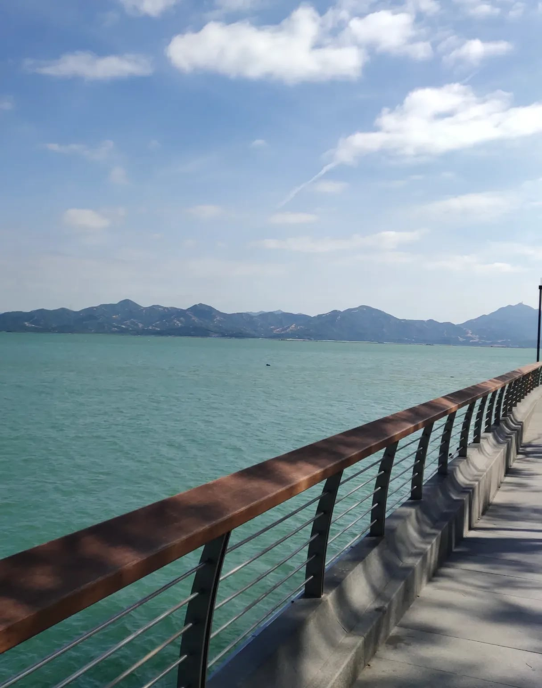
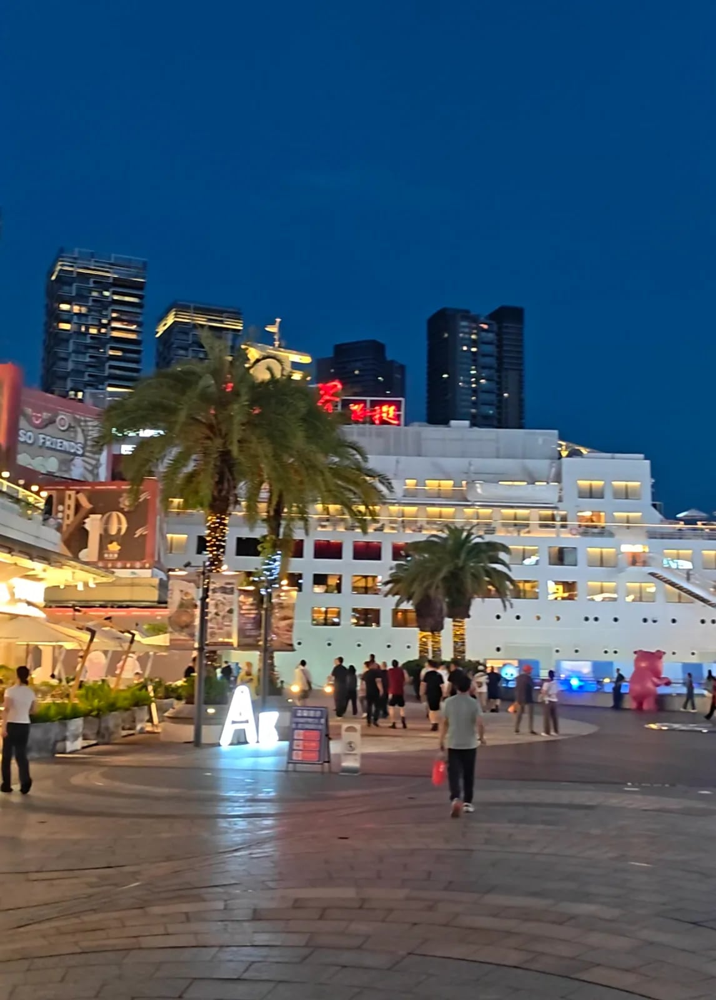
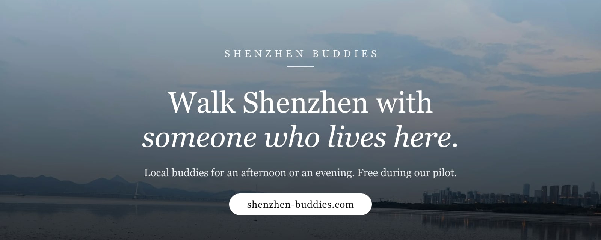

# APEC 2026 in Shenzhen: what visitors need to know

*The leaders’ meeting is on 18 and 19 November. Road rules, half-price metro and visas for anyone visiting Shenzhen that week.*

By Bryan Wang, co-founder of Shenzhen Buddies. Lives in Shenzhen. Last checked: 3 November 2026.

*The exchange centre in August 2026, three months before the meeting.*
*Photo: [Lhzss8](https://commons.wikimedia.org/wiki/File:%E6%B7%B1%E5%9C%B3%E5%9B%BD%E9%99%85%E4%BA%A4%E6%B5%81%E4%B8%AD%E5%BF%83.jpg) · [CC BY-SA 4.0](https://creativecommons.org/licenses/by-sa/4.0/) · via Wikimedia Commons · resized*

In the middle of November, Shenzhen hosts the APEC leaders’ meeting. Leaders from twenty-one economies come to Futian, the central district, for two days, and the streets around the venue are expected to be shut while they are there. China has done this twice before, in Shanghai in 2001 and in Beijing in 2014. It is the first time for Shenzhen, and the city has been getting ready for a year.

We live here and have watched the preparations. The venue at Xiangmi Lake was finished over the past year, and the traffic notices came out on 3 November. This is what we know as of early November, and what it means if you are in Shenzhen that week, for the meeting or not.

## The meeting

APEC is the Asia-Pacific Economic Cooperation forum. Twenty-one economies around the Pacific belong to it, from Chile to Thailand, and their leaders have met once a year since 1993. They are called economies rather than countries, which is how Hong Kong and Chinese Taipei each have a seat of their own. It is a forum rather than a treaty body. The leaders’ meeting is simply the two days a year when they are all in one place. China has given its year the slogan ‘Building an Asia-Pacific Community to Prosper Together’. The three priorities under it are openness, innovation and cooperation.

*Beijing, 10 November 2014: the leaders and their spouses in jackets the host had made for the occasion. Every APEC host stages a group photo like this.*
*Photo: [Kremlin.ru](https://commons.wikimedia.org/wiki/File:APEC_Summit_China_2014.jpg) · [CC BY 4.0](https://creativecommons.org/licenses/by/4.0/) · via Wikimedia Commons · resized*

The 33rd leaders’ meeting is on 18 and 19 November 2026. The CEO Summit runs on 17 and 18 November, and the last senior officials’ meeting on 14 and 15 November. The main venue is the Shenzhen International Exchange Center at Xiangmi Lake in Futian. It is a new building with a long cantilevered roof and a hotel on either side, one of which opens in December. The architects were He Jingtang’s team, who did the China pavilion at the Shanghai Expo. The APEC forestry ministers’ meeting in July was its first big event. None of it is open to the public.

## The week: 16 to 20 November

There is no general public holiday. Primary and secondary schools and most kindergartens are on an autumn break from 17 to 20 November. The city is taking 90 per cent of its official cars off the road, and companies are asked to let people work from home, stagger their hours or take leave in the week of 16 to 20 November. The metro and buses are due to be half price for the meeting period, with some lines running a train every two minutes and more than fifty extra bus routes feeding metro stations. The exact dates of the discount had not been published when we wrote this. Residents can register to leave their car parked for the week in exchange for a commemorative transport card. Beijing went further in 2014 and gave government offices and schools six days off.

| Dates | Rule | Who it affects |
|---|---|---|
| 7 to 10 November | No drones, kites or sky lanterns in Futian and Nanshan districts | Anyone flying a drone in those two districts |
| 11 to 21 November | The same ban across the whole city | Anyone flying a drone |
| Until 23 November | Nothing airborne at all in the streets around the venue, between Xinzhou Road and Nonglin Road, under a separate police notice from July | Anyone flying a drone near Xiangmi Lake |
| 16 to 20 November | Hazardous-goods trucks banned citywide; companies asked to work flexibly | Mostly residents |
| 17 to 20 November, 6am to 10pm | Cars with plates from outside Shenzhen banned from Futian, Luohu, Nanshan, Bao’an, Longgang and Longhua, with the airport roads excepted. Hong Kong and Macau plates are exempt. | Anyone driving in from another mainland city |
| 18 and 19 November, 6am to 10pm | Small trucks banned from Futian, Luohu and Nanshan | Couriers, and shops waiting for deliveries |
| 18 and 19 November | The leaders’ meeting itself. Closures around Xiangmi Lake and the delegation hotels are expected but had not been announced when we wrote this. | Everyone in central Futian |

The car ban and the citywide drone ban are city government decisions. The two truck bans and the no-fly zone around the venue come from the police. The car, drone and truck bans were all published on 3 November. Leave the drone at home. Apart from the drone ban and the closures expected around the venue on the two meeting days, the only rule a visitor is likely to run into is the car ban, and even then only if you have driven in from another city. Licensed taxis and ride-hailing cars are exempt whatever their plates, so getting around inside the city is unchanged, apart from Futian traffic being slow that week. Hire cars are not exempt, so do not drive one in from Guangzhou or Dongguan. The city wants everyone on the metro that week. We would say the same; it is how we get about anyway.

## Should you come that week?

If you are here for the meeting the question does not arise, and the useful part for you is the list under ‘How we can help that week’. If you are coming for the city, you will manage, but expect queues and detours. Bag checks on the metro have tightened, and Xiangmi Lake is expected to be cordoned off on the meeting days. Nothing else has been announced as closed, and the metro should be cheaper and more frequent than usual. If you have not booked a hotel yet, book one outside central Futian, meaning the business district around Civic Center and the lake to its west.

Our own plan is to stay out of central Futian on the two meeting days. The western waterfront in Nanshan is on the metro and well away from the venue. It runs from [Shenzhen Bay Park, past Talent Park, to Sea World](https://www.shenzhen-buddies.com/blog/shenzhen-bay-waterfront?utm_source=syndication&utm_medium=blog&utm_campaign=apec-2026-shenzhen) at Shekou, the old port at the far western end. Sea World is a plaza of bars and restaurants, not an aquarium. [Dongmen](https://www.shenzhen-buddies.com/blog/dongmen-old-downtown?utm_source=syndication&utm_medium=blog&utm_campaign=apec-2026-shenzhen) is in Luohu, the next district east. Dafen, the painting village, and Overseas Chinese Town, the theme-park and arts district, are outside Futian too. We would skip [our Futian skyline walk](https://www.shenzhen-buddies.com/blog/futian-new-downtown?utm_source=syndication&utm_medium=blog&utm_campaign=apec-2026-shenzhen) on the two meeting nights. Nobody knows yet how far the cordon will reach.

*Shenzhen Bay on a clear day. The hills across the water are Hong Kong.*

## Getting in

Many visitors no longer need a visa. China’s unilateral visa-free entry covers ordinary passports from fifty countries, including Japan, Australia, most of Europe and, since 17 February 2026, the United Kingdom and Canada, for stays of up to thirty days. The policy currently runs to 31 December 2026. The United States is not on the list. Travellers from fifty-seven countries, Americans among them, can use the 240-hour visa-free transit instead if they are moving on to a third country or region. Since 1 November, holders of an APEC Business Travel Card can stay ninety days rather than sixty.

From Hong Kong the crossings should work as they always do, with longer queues. Our [border-crossing guide](https://www.shenzhen-buddies.com/blog/shenzhen-from-hong-kong-day-trip?utm_source=syndication&utm_medium=blog&utm_campaign=apec-2026-shenzhen) covers which crossing to use and which apps to install. Set the apps up before you leave.

## Paying for things

In our experience most visitors clear immigration without trouble and then cannot pay for lunch. The city has spent the year preparing for foreign cards. The central bank’s Shenzhen branch says more than 41,000 merchants and more than 3,600 cash machines now take overseas cards, and there are eight payment help desks at the airport and the border crossings from Hong Kong, including the Shenzhen Bay, Futian and Luohu checkpoints. Useful as far as it goes, but it covers the department stores and the help desks, not the noodle shop you will end up in. Taxis, street food, shared bikes and the beer stands on the Sea World plaza are paid for on Alipay or WeChat Pay, so have both working before you arrive.

## How we can help that week

Shenzhen Buddies pairs visitors with a local for two or three hours, free during our pilot. The buddy sets up your payment apps, orders your dinner and sees you onto the right train back. In APEC week we expect it to be one of four things.

- A delegate with only the evenings free gets met at a metro exit and walked to Sea World or to Talent Park for the towers lit up across the water, with no taxi involved.
- A partner who is not attending gets an afternoon with a buddy at the waterfront, in Dafen or in the Huaqiangbei electronics markets, which are at the east end of Futian and well clear of the lake, and dinner somewhere we would eat ourselves.
- Press and delegation staff who need something specific, such as a place to film the skyline or a menu read over the phone, can write to us and we will say whether we can do it.
- An ordinary visitor gets an afternoon planned around the road rules: metro rather than taxis, and nothing near Xiangmi Lake on the meeting days.

*The Minghua at Sea World after dark, where the evening walk ends.*

**Book a buddy for APEC week.** Tell us your dates and what you need: [shenzhen-buddies.com/guide](https://www.shenzhen-buddies.com/guide?utm_source=syndication&utm_medium=blog&utm_campaign=apec-2026-shenzhen).

More notices will follow. Everything above is what had been published as of 3 November 2026. The city said in October that traffic measures would come out in stages, and nothing yet covers particular roads on the two meeting days. Check the Shenzhen Traffic Police account on WeChat or the city government site the day before you set out. Do not rely on a blog post written a fortnight earlier.

The car ban lifts on the evening of 20 November, the citywide drone ban after 21 November, and the no-fly zone around the venue after 23 November. If your dates are flexible, the week after is easier. If not, keep out of central Futian on the two meeting days. Elsewhere the difference will be longer bag checks and a cheaper metro.

## Talk to us before you arrive

Write to us and we will reply the same day. WhatsApp is quickest from outside China, and WeChat once you are on the mainland side.

- **WhatsApp:** [WhatsApp number]
- **WeChat ID:** bryan_wangqian
- **Email:** tensaitech.admin@gmail.com
- **Web:** [shenzhen-buddies.com](https://www.shenzhen-buddies.com/welcome?utm_source=syndication&utm_medium=blog&utm_campaign=apec-2026-shenzhen&utm_content=contact)

---

## FAQ

**When is APEC 2026?**
The 33rd APEC Economic Leaders’ Meeting is on 18 and 19 November 2026 in Shenzhen. The CEO Summit is on 17 and 18 November and the final senior officials’ meeting on 14 and 15 November. Ministerial meetings ran all year, including the forestry ministers in Shenzhen in July and the finance ministers in Hong Kong in October.

**Where is the APEC 2026 venue?**
The Shenzhen International Exchange Center at Xiangmi Lake in Futian District, west of the central business district. It is a new conference centre designed by He Jingtang’s team, finished this year, with a hotel on either side, one of which opens in December. Visitors cannot go in.

**Is there a public holiday in Shenzhen for APEC?**
No. The city said on 15 October 2026 that there is no general holiday, though primary and secondary schools and most kindergartens are on an autumn break from 17 to 20 November. Companies are encouraged to allow remote work, flexible hours or leave from 16 to 20 November.

**Will roads be closed in Shenzhen during APEC?**
Probably, around Xiangmi Lake on 18 and 19 November, but as of 3 November no specific closures had been announced. What has been announced is a ban on cars with plates from outside Shenzhen in six districts from 6am to 10pm on 17 to 20 November, a ban on small trucks in Futian, Luohu and Nanshan on 18 and 19 November, and a citywide ban on drones and kites from 11 to 21 November. The metro and buses are due to run at half price with extra capacity.

**Can tourists visit Shenzhen during APEC 2026?**
Yes. No attractions have been announced as closed, visa-free entry for fifty countries continues to the end of 2026, and the metro should be cheaper that week. Avoid central Futian on 18 and 19 November and book a hotel outside the centre. Taxis are exempt from the ban on out-of-town cars but will be slow in Futian that week.

---

## Walk Shenzhen with someone who lives here

**Shenzhen Buddies** is a small company run by people who live in Shenzhen. We pair visitors with a local buddy for two or three hours, an afternoon or an evening. Your buddy sorts out the apps, orders the food and keeps an eye on the clock. You see the city as we use it.

Tours are **free while we are in our pilot**. Pick a walk and a day and we will sort the rest.

- **Browse the walks:** [shenzhen-buddies.com/tours](https://www.shenzhen-buddies.com/tours?utm_source=syndication&utm_medium=blog&utm_campaign=apec-2026-shenzhen&utm_content=banner)
- **Start here if it is your first time in Shenzhen:** [shenzhen-buddies.com/welcome](https://www.shenzhen-buddies.com/welcome?utm_source=syndication&utm_medium=blog&utm_campaign=apec-2026-shenzhen&utm_content=banner)
- **More from the Journal:** [shenzhen-buddies.com/blog](https://www.shenzhen-buddies.com/blog?utm_source=syndication&utm_medium=blog&utm_campaign=apec-2026-shenzhen&utm_content=banner)
- **Follow along:** [Instagram](https://www.instagram.com/shenzhenbuddies/) · [TikTok](https://www.tiktok.com/@shenzhenbuddies) · [Threads](https://www.threads.com/@shenzhenbuddies) · [X](https://x.com/shenzhenbuddies)

Live in Shenzhen and want to show people around? [Write to us](https://www.shenzhen-buddies.com/contact?utm_source=syndication&utm_medium=blog&utm_campaign=apec-2026-shenzhen&utm_content=banner). We are looking for buddies too.

*Originally published at [shenzhen-buddies.com](https://www.shenzhen-buddies.com/blog/apec-2026-shenzhen).*
