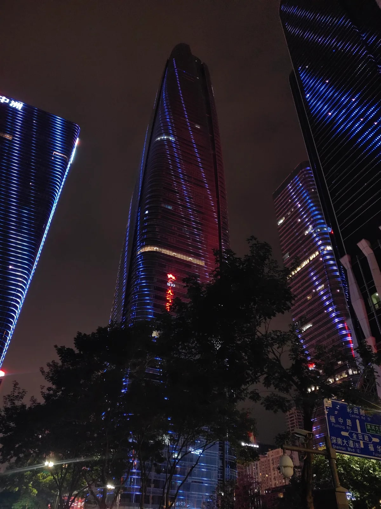
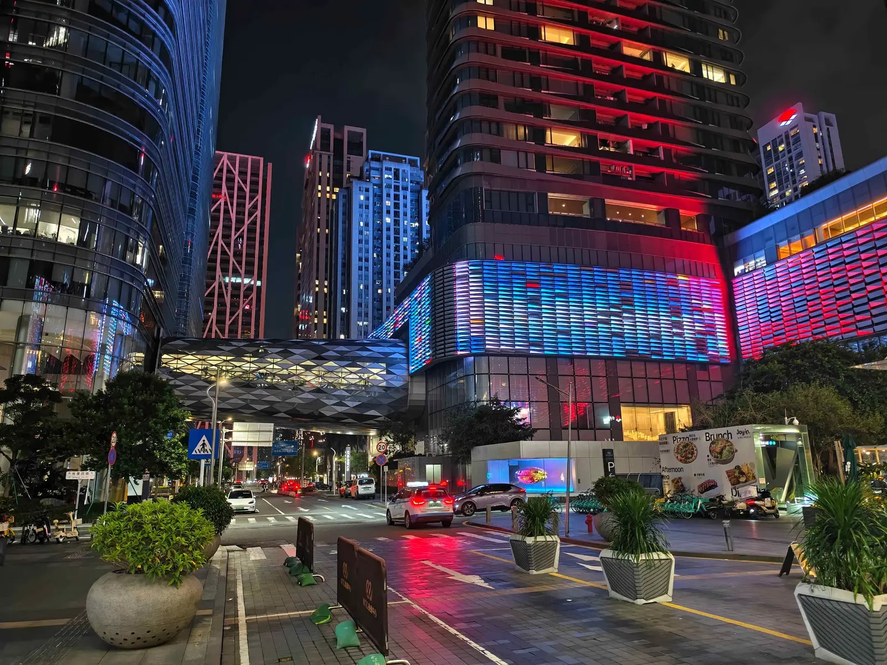

# APEC 2026 in Shenzhen: what visitors need to know

*The leaders’ meeting is on 18 and 19 November. Road rules, half-price metro and visas for anyone visiting Shenzhen that week.*

By Bryan Wang, co-founder of Shenzhen Buddies. Lives in Shenzhen. Last checked: 3 November 2026.

In the middle of November, Shenzhen hosts the APEC leaders’ meeting. Leaders from twenty-one economies come to Futian for two days, and the streets around the venue are expected to be shut while they are there. China has done this twice before, in Shanghai in 2001 and in Beijing in 2014. It is the first time for Shenzhen, and the city has been getting ready for a year.

We live here, so we have watched the preparations happen. The venue by the lake went up and the e-scooter crackdown came in the spring. The road notices started arriving this month. This is what we know as of early November, and what it means if you are visiting that week, whether or not you are here for the meeting.

## The meeting

APEC is the Asia-Pacific Economic Cooperation forum. Twenty-one economies around the Pacific belong to it, from Chile to Thailand, and their leaders have met once a year since 1993. It is a forum rather than a treaty body, and the leaders’ meeting is the two days a year when they sit in the same room. China’s theme for its year is “Building an Asia-Pacific Community to Prosper Together”, with openness, innovation and cooperation as the three priorities.

The 33rd leaders’ meeting is on 18 and 19 November 2026. The CEO Summit runs on 17 and 18 November, and the last senior officials’ meeting on 14 and 15 November. The main venue is the Shenzhen International Exchange Center at Xiangmi Lake in Futian, a new building by He Jingtang’s team with a deep overhanging roof and two hotels built alongside it. It opened this year, and the APEC forestry ministers’ meeting in July was its first event. None of it is open to the public. The streets around it will almost certainly be closed too, though that notice has not been published yet.

*Futian after dark. The meeting is a short way west of this, at Xiangmi Lake.*

## The week: 16 to 20 November

There is no public holiday, which is a change from Beijing, where government offices and schools were given six days off in 2014. Shenzhen is asking companies to let people work from home, stagger their hours or take leave in the week of 16 to 20 November, and that is all it is asking. The metro and buses will be half price for the meeting period, some lines will run a train every two minutes, and fifty extra feeder bus routes go in. The exact dates of the discount had not been published when we wrote this. Residents can even register to leave their car parked for the week in exchange for a commemorative transit card.

| Dates | Rule | Who it affects |
|---|---|---|
| 7 to 10 November | No drones, kites or sky lanterns in Futian and Nanshan | Anyone with a drone in those two districts |
| 11 to 21 November | The same ban across the whole city | Anyone with a drone |
| 16 to 20 November | Hazardous-goods trucks banned citywide; companies asked to work flexibly | Residents more than visitors |
| 17 to 20 November, 6am to 10pm | Cars with plates from outside Shenzhen banned from Futian, Luohu, Nanshan, Bao’an, Longgang and Longhua, with the airport roads excepted. Hong Kong plates are exempt. | Anyone driving in from another mainland city |
| 18 and 19 November, 6am to 10pm | Small trucks banned from Futian, Luohu and Nanshan | Couriers, and shops waiting on deliveries |
| 18 and 19 November | The leaders’ meeting itself. Closures around Xiangmi Lake and the delegation hotels are likely but had not been announced as of 3 November. | Everyone in central Futian |

The car and drone rules are decisions of the city government, the truck rules come from the Shenzhen police, and all three were published on 3 November. The rule that matters to a visitor is the car ban, and since it covers plates from outside the city, Shenzhen’s own taxis and ride-hailing cars are not affected by it. Rental cars are not exempt, so do not plan to drive one in from Guangzhou or Dongguan that week. The city has said it wants people on the metro all the same, and that is how we get around in any case.

## Should you come that week?

If you are here for the meeting the question does not arise, and the useful part for you is the list under ‘How we can help that week’. If you are coming for the city, it will work, with some friction. The police presence has been obvious since the start of the month, and Xiangmi Lake will be cordoned off on the meeting days. Nothing else has been announced as closed, and the metro will be cheaper and more frequent than usual.

Our plan for that week keeps out of central Futian during the day. The west coast, which is [Shenzhen Bay, Talent Park and Sea World](https://www.shenzhen-buddies.com/blog/shenzhen-bay-waterfront?utm_source=syndication&utm_medium=blog&utm_campaign=apec-2026-shenzhen), is a metro ride from wherever you are staying. [Dongmen](https://www.shenzhen-buddies.com/blog/dongmen-old-downtown?utm_source=syndication&utm_medium=blog&utm_campaign=apec-2026-shenzhen) is in Luohu, on the far side of the centre. Dafen and OCT are in their own corners. We would skip the Futian skyline walk on the two meeting nights, since the cordon will be a few streets west of it.

## Getting in

Many visitors no longer need a visa. China’s unilateral visa-free entry covers ordinary passports from fifty countries, including Japan, Australia, most of Europe and, since 17 February 2026, the United Kingdom and Canada, for stays of up to thirty days. The policy currently runs to 31 December 2026. The United States is not on the list. Travellers from fifty-seven countries, Americans among them, can use the 240-hour visa-free transit instead if they are moving on to a third country or region. Holders of an APEC Business Travel Card can stay up to ninety days from 1 November, up from sixty.

From Hong Kong the crossings work as they always do, with longer queues. Our [border-crossing guide](https://www.shenzhen-buddies.com/blog/shenzhen-from-hong-kong-day-trip?utm_source=syndication&utm_medium=blog&utm_campaign=apec-2026-shenzhen) covers which crossing to use and which apps to install. Set the apps up before you leave. Payments trip more people up here than passports do.

## Paying for things

The city has spent the year preparing for foreign cards. The central bank’s Shenzhen branch says more than 41,000 merchants and 3,600 cash machines now take overseas cards, and there are payment help desks at the airport, Shenzhen Bay port, Futian port and Luohu port. That is new, and it holds at the help desks and the big shops. It does not hold at the places you will eat. Taxis, street food, shared bikes and the beer tower on the Sea World plaza are paid for on Alipay or WeChat Pay, so have both working before you arrive.

## How we can help that week

Shenzhen Buddies pairs visitors with a local, for two or three hours, free during our pilot. The buddy sets up your payments with you and tests them, orders dinner, reads the metro map and gets you to wherever you were trying to go. In APEC week it comes down to a few situations.

- A delegate with only the evenings free gets met at a metro exit and walked to Sea World or the Talent Park lights, with no car involved.
- A partner who is not attending can have a buddy for the day at the waterfront, in Dafen or in the electronics markets, and eat somewhere we would eat ourselves.
- Press and delegation staff who need something specific, such as a place to film the skyline or a menu read over the phone, can write to us and we will say whether we can do it.
- An ordinary visitor gets a day planned around the road rules: metro rather than taxis, and nothing near Xiangmi Lake on the meeting days.

**Book a buddy for APEC week.** Evenings, a day out for a partner, or a specific request. Tell us the dates: [shenzhen-buddies.com/guide](https://www.shenzhen-buddies.com/guide?utm_source=syndication&utm_medium=blog&utm_campaign=apec-2026-shenzhen).

**Rules change by the day.** Everything above is what had been published as of 3 November 2026. The city said in October that traffic measures would be released in stages, and nothing yet covers particular roads on the two meeting days. Check the Shenzhen Traffic Police account on WeChat or the city government site the day before you move, and treat anything from a travel blog, including this one, as a starting point.

The meeting takes two days, the car ban lifts on the evening of the twentieth, and the drone ban, the last of the notices, expires on the twenty-first. If your dates are flexible, the week after is easier. If they are not, the evenings are mostly unaffected and the metro is half price.

## Talk to us before you arrive

Write to us and we reply the same day. WhatsApp is quickest from outside China, and WeChat once you are on the mainland side.

- **WhatsApp:** [WhatsApp number]
- **WeChat ID:** bryan_wangqian
- **Email:** tensaitech.admin@gmail.com
- **Web:** [shenzhen-buddies.com](https://www.shenzhen-buddies.com/welcome?utm_source=syndication&utm_medium=blog&utm_campaign=apec-2026-shenzhen&utm_content=contact)

---

## FAQ

**When is APEC 2026?**
The 33rd APEC Economic Leaders’ Meeting is on 18 and 19 November 2026 in Shenzhen. The CEO Summit is on 17 and 18 November and the final senior officials’ meeting on 14 and 15 November. Ministerial meetings ran all year in other Chinese cities, including the finance ministers in Hong Kong in October.

**Where is the APEC 2026 venue?**
The Shenzhen International Exchange Center at Xiangmi Lake in Futian District, west of the CBD. It is a new conference centre with two hotels built alongside it, designed by He Jingtang’s team and finished this year. Visitors cannot go in.

**Is there a public holiday in Shenzhen for APEC?**
No. The city said on 15 October 2026 that there is no general holiday. Companies are encouraged to allow remote work, flexible hours or leave from 16 to 20 November.

**Will roads be closed in Shenzhen during APEC?**
Yes, in stages, though no specific road closures had been announced as of 3 November. Cars with plates from outside Shenzhen are banned from six districts from 6am to 10pm on 17 to 20 November, small trucks from Futian, Luohu and Nanshan on 18 and 19 November, and drones and kites citywide from 11 to 21 November. Expect closures around Xiangmi Lake on the meeting days. The metro and buses run at half price with extra capacity.

**Can tourists visit Shenzhen during APEC 2026?**
Yes. No attractions have been announced as closed, visa-free entry for fifty countries continues to the end of 2026, and the metro is cheaper that week. Avoid central Futian on 18 and 19 November, book a hotel outside the centre, and expect taxis to be slow in Futian.

---

## Walk Shenzhen with someone who lives here

**Shenzhen Buddies** is a small company run by people who live in Shenzhen. We pair visitors with a local buddy for an afternoon or an evening: the waterfront at dusk, the electronics markets, the old town, dinner at a place with no English on the menu. Your buddy handles the apps, the ordering and the timing, and you get the city the way it is lived in, not the way it is toured.

Tours are **free while we are in our pilot**. Pick a walk, choose a day, and we take care of the rest.

- **Browse the walks:** [shenzhen-buddies.com/tours](https://www.shenzhen-buddies.com/tours?utm_source=syndication&utm_medium=blog&utm_campaign=apec-2026-shenzhen&utm_content=banner)
- **Start here if it is your first time in Shenzhen:** [shenzhen-buddies.com/welcome](https://www.shenzhen-buddies.com/welcome?utm_source=syndication&utm_medium=blog&utm_campaign=apec-2026-shenzhen&utm_content=banner)
- **More from the Journal:** [shenzhen-buddies.com/blog](https://www.shenzhen-buddies.com/blog?utm_source=syndication&utm_medium=blog&utm_campaign=apec-2026-shenzhen&utm_content=banner)
- **Follow along:** [Instagram](https://www.instagram.com/shenzhenbuddies/) · [TikTok](https://www.tiktok.com/@shenzhenbuddies) · [Threads](https://www.threads.com/@shenzhenbuddies) · [X](https://x.com/shenzhenbuddies)

Live in Shenzhen and want to show people around? [Write to us](https://www.shenzhen-buddies.com/contact?utm_source=syndication&utm_medium=blog&utm_campaign=apec-2026-shenzhen&utm_content=banner). We are looking for buddies too.

*Originally published at [shenzhen-buddies.com](https://www.shenzhen-buddies.com/blog/apec-2026-shenzhen).*
