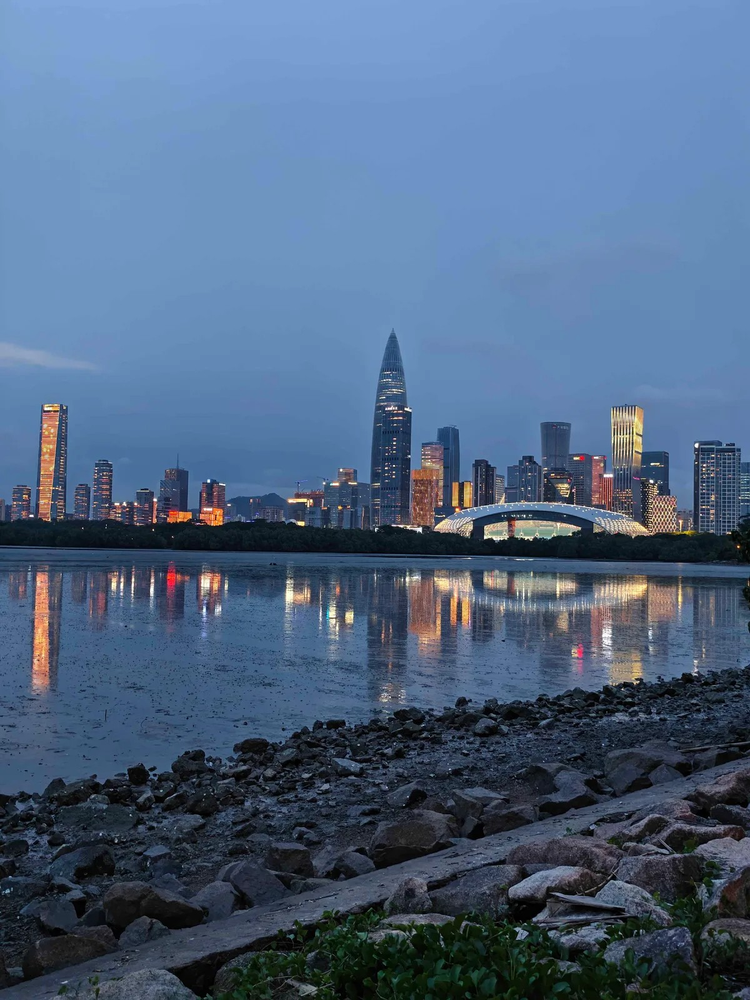
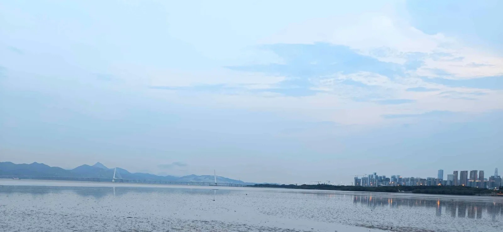
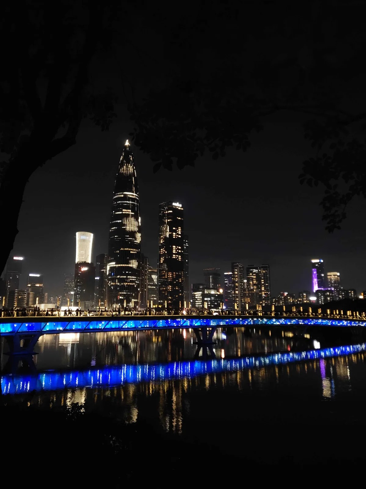
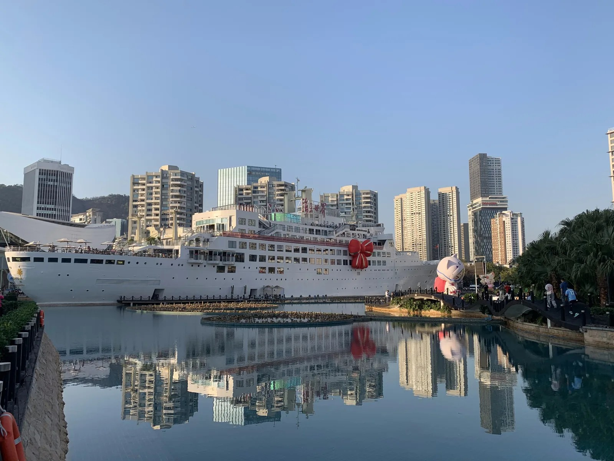
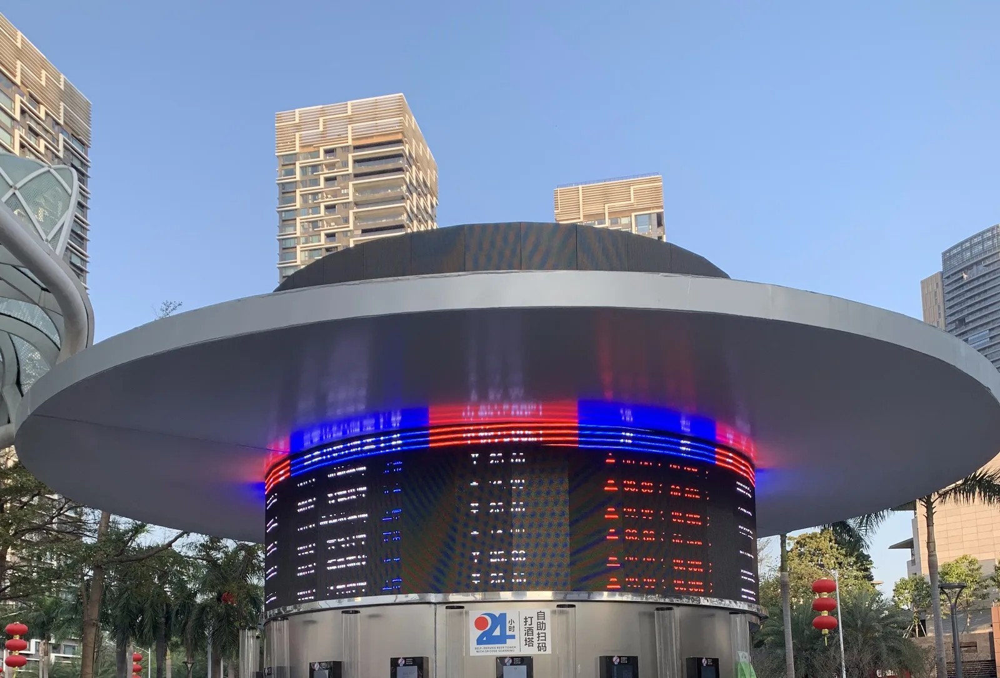
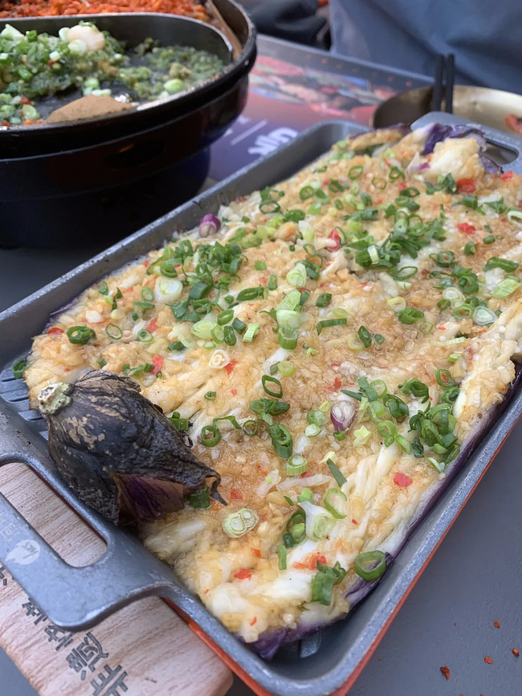

# Shenzhen Bay: where the city stops

*Thirteen kilometres of waterfront with Hong Kong on the far side, and a liner in Shekou that has not been to sea since 1983. How we do the west coast.*

By Bryan Wang, co-founder of Shenzhen Buddies. Lives in Shenzhen.

Most of Shenzhen is inland. The towers go on for an hour on the metro in either direction and you can forget there is a coast at all. In Nanshan the towers run out at a railing, and Hong Kong is on the other side of the water.

This is the stretch we take people to when they have seen enough glass. Shenzhen Bay Park at one end, Sea World in Shekou at the other, and Talent Park with the Houhai towers in between. All of it is on the same shore, and you can do it in an afternoon that ends after dark, on foot or on a bike.

## The bay

Shenzhen Bay Park is about thirteen kilometres of waterfront, opened in 2011, free, with one path for walking and another for bikes. It runs from the mangrove reserve on the Futian side to the bridge at the far west end. That bridge is the road to Hong Kong, and the hills behind it are the New Territories. On a clear day you can count the apartment towers of Tin Shui Wai. Nothing marks the border on the water, so most people do not realise they are looking at one.

*Low tide, looking west towards the bridge. Everything beyond it is Hong Kong.*

The bay is shallow, and the tide changes it completely. When it is out, the mud goes a long way, and families come down the rocks with buckets to dig for clams. When it is in, the water comes up to the wall and the whole skyline is reflected in it. In winter, roughly November to March, the bay fills with migratory birds, including the black-faced spoonbill, which is rare enough that people fly in to see it. The mangrove end is where they feed. The rest of the year it is egrets, and a lot of people flying kites.

The park is long and flat, which is why we ride it. The bike path is separate from the walking path, so nobody has to dodge anybody, and the bikes are sorted out at the start. On weekends and public holidays the park closes to shared bikes during the day, so the ride is a weekday plan. [The bay ride](https://www.shenzhen-buddies.com/tours/shenzhen-bay-cycling?utm_source=syndication&utm_medium=blog&utm_campaign=shenzhen-bay-waterfront) covers the best stretch of it in two or three hours.

## Talent Park and the Houhai towers

Halfway along, the park turns inland around a lake. This is Talent Park, opened in 2017 on reclaimed land and named, in earnest, after the city's talent, which here mostly means engineers. Across the lake is the Houhai skyline, which is the one on the cover of this post. The tapered tower is the China Resources headquarters, 392 metres, finished in 2018. Everyone here calls it the Spring Bamboo. The white mesh dome beside it, the Spring Cocoon, is the Shenzhen Bay Sports Center, built for the student games in 2011.

*Talent Park from the lake side, a few minutes after the towers came on.*

The park is at its best in the last hour of light. The towers come on one by one and the footbridge turns blue. If there is no wind, the lake reflects all of it. On holiday nights there is sometimes a drone show over the bay. We do not plan around it, because the dates are announced only days ahead and the viewing spots book out within the hour. [The Talent Park walk](https://www.shenzhen-buddies.com/tours/talent-park-night?utm_source=syndication&utm_medium=blog&utm_campaign=shenzhen-bay-waterfront) is timed to end with the lights.

## Sea World

Keep going west and the towers thin out. This is Shekou, the old port, and the part of the city where the foreigners have always lived. In the middle of it is a white ocean liner, sitting in a pond. The ship is the Minghua. She was built in France in 1962, bought by China in 1973, and moored here in 1983, where she became a hotel. Then the city reclaimed the land around her, and she has been a few hundred metres inland ever since. There is still a hotel on board, and restaurants. Nobody has been to sea on her in forty years.

*The Minghua in daylight. The land around her was all water when she arrived.*

The plaza around her is Sea World, which is where Shekou goes in the evening. The fountains come on after dark and the restaurants put their tables out on the square. There is more English on the menus here than anywhere else in Shenzhen. Our favourite thing on the plaza is a round kiosk with a saucer roof that sells beer from taps, with no staff. You scan a code, pour your own glass, and the tap charges you for what you poured. It is open all night. [Sea World after dark](https://www.shenzhen-buddies.com/tours/shekou-sea-world?utm_source=syndication&utm_medium=blog&utm_campaign=shenzhen-bay-waterfront) starts at the metro exit and ends on the plaza.

*The beer tower on the plaza, before the evening crowd.*

## Dinner in Shekou

*Grilled eggplant on an iron tray, which keeps it hot longer than you need.*

Shekou eats late and outdoors. The streets behind the plaza are full of grills, and the thing to order at any of them is the eggplant. It is split down the middle, grilled until it collapses, and covered in minced garlic and spring onion. One tray feeds two people. Order skewers with it, or whatever the next table has, and walk back to the water afterwards. What else to eat in this city, and how to order it, is in [our food guide](https://www.shenzhen-buddies.com/blog/what-shenzhen-actually-eats?utm_source=syndication&utm_medium=blog&utm_campaign=shenzhen-bay-waterfront).

## Go at the right hour

Start at the Futian end of the bay in the middle of the afternoon, when the light is flat and the path is empty. Ride or walk west and be at Talent Park an hour before sunset. Stay for the lights. Then take Line 2 six stops west to Sea World for the fountains and dinner. Doing it the other way round means walking the bay in the dark, which is pleasant but wastes the view. The rest of the night is in [our after-dark guide](https://www.shenzhen-buddies.com/blog/shenzhen-after-dark?utm_source=syndication&utm_medium=blog&utm_campaign=shenzhen-bay-waterfront).

- Shenzhen Bay Park has its own metro station on Line 9. Use the exit on the park side of Binhai Boulevard and you are at the water in a few minutes. Talent Park is a short walk from Houhai station. Sea World has its own station too, on Lines 2 and 12, and Exit A puts you almost on the plaza.
- Everything from the bikes to the beer tower is paid by phone. Do the setup in [our border-crossing guide](https://www.shenzhen-buddies.com/blog/shenzhen-from-hong-kong-day-trip?utm_source=syndication&utm_medium=blog&utm_campaign=shenzhen-bay-waterfront) before you come down to the water.
- Check the haze before you commit. If you cannot see the hills across the bay from the Futian end, Hong Kong will not appear later either. Save the day for Dongmen and come back when the air is clear.

**If you only have one evening.** Skip the bay ride and go straight to Talent Park an hour before sunset. Wait for the lights, then take the metro to Sea World for dinner. You miss the ride and the mudflats, which is a fair trade for one night.

Most visitors never come down here. People who live in Shenzhen spend their Sundays on it. Give it an afternoon.

---

**Want to walk it with someone who lives here?** Shenzhen Buddies pairs you with a local for Talent Park at sunset or Sea World after dark. [Book a waterfront evening](https://www.shenzhen-buddies.com/tours/shekou-sea-world?utm_source=syndication&utm_medium=blog&utm_campaign=shenzhen-bay-waterfront).

*Originally published at [shenzhen-buddies.com](https://www.shenzhen-buddies.com/blog/shenzhen-bay-waterfront).*

---

## FAQ

**What is Shenzhen Bay Park?**
A free coastal park in Nanshan, about thirteen kilometres long, that runs from the Futian mangrove reserve to the Shenzhen Bay Bridge. It opened in 2011 and has separate paths for walking and cycling. Hong Kong is across the water.

**Can you see Hong Kong from Shenzhen Bay?**
Yes. The hills across the water are the New Territories, and on a clear day the apartment towers of Tin Shui Wai are visible. The bridge at the west end of the park is the road crossing to Hong Kong. Haze hides all of it, so check the air before you go.

**What is the ship at Sea World?**
The Minghua, a liner built in France in 1962 as the Ancerville. China bought her in 1973 and moored her at Shekou in 1983, where she became a hotel. The land around her was reclaimed later, so she now sits in a pond in the middle of the Sea World plaza, with a hotel and restaurants on board.

**How do I get to Sea World in Shenzhen?**
Take the metro to Sea World station on Line 2 or Line 12 and leave by Exit A, a short walk from the plaza. Shenzhen Bay Park has its own station on Line 9, and Talent Park is a short walk from Houhai station.

**When is the best time to visit Shenzhen Bay?**
Late afternoon into evening, so you reach Talent Park an hour before sunset and Sea World after dark. For the migratory birds, including the black-faced spoonbill, come between November and March and go to the mangrove end of the park.
